<!-- Generated by tools/build.py from tools/content.py. Edit the content there, then run the script. -->

<picture><source media="(prefers-color-scheme: dark)" srcset="assets/header/banner-fr-dark.svg"><source media="(prefers-color-scheme: light)" srcset="assets/header/banner-fr-light.svg"></picture>

  <code>jolan@norkenix.com</code>

<picture><source media="(prefers-color-scheme: dark)" srcset="https://raw.githubusercontent.com/PercyaDJ/PercyaDJ/live/nowline-fr-dark.svg"><source media="(prefers-color-scheme: light)" srcset="https://raw.githubusercontent.com/PercyaDJ/PercyaDJ/live/nowline-fr-light.svg"></picture>

<picture><source media="(prefers-color-scheme: dark)" srcset="assets/header/signs-fr-dark.svg"><source media="(prefers-color-scheme: light)" srcset="assets/header/signs-fr-light.svg"><picture><source media="(prefers-color-scheme: dark)" srcset="assets/header/signs-fr-dark.svg"><source media="(prefers-color-scheme: light)" srcset="assets/header/signs-fr-light.svg"></picture></picture>

**30 secondes.** Consultant en cybersécurité et conformité, certifié ISO 27001 Lead Implementer. Je mets les entreprises en conformité (NIS2, RGPD, CRA) et je construis les outils qui automatisent ce travail grâce à l'IA locale.

**Côté tech.** TypeScript, Python, Rust, PHP · IA locale (Ollama, LM Studio, Mistral, Qwen, Codestral) et serveurs MCP · Semgrep, Trivy, Syft. L'IA écrit une bonne partie du code. Je porte l'architecture, la relecture, les tests et le durcissement.

**Côté humain.** Photographe d'aurores boréales et curieux de tout. Un nouveau sujet ? Je m'y mets.

<picture><source media="(prefers-color-scheme: dark)" srcset="assets/sections/section-lowsper-fr-dark.svg"><source media="(prefers-color-scheme: light)" srcset="assets/sections/section-lowsper-fr-light.svg"></picture>

<b>Détails techniques</b> · <a href="https://github.com/PercyaDJ/Lowsper">Voir le projet →</a>

Whisper dans le navigateur · un seul fichier HTML, sans installation ni droits administrateur · séparation des intervenants · glossaire métier · import de fichiers audio · export Markdown vers Obsidian · JavaScript · licence MIT.

<picture><source media="(prefers-color-scheme: dark)" srcset="assets/sections/section-lysbor-fr-dark.svg"><source media="(prefers-color-scheme: light)" srcset="assets/sections/section-lysbor-fr-light.svg"></picture>

<b>Détails techniques</b> · <a href="https://lysbor.com/">Essayer la démo →</a>

Agent CI/CD · analyse statique du code (SAST, Semgrep) · analyse des dépendances et des images (SCA, Trivy) · génération de SBOM (Syft) · détection de secrets · plans d'action avec responsables · alertes de déclaration CRA · SaaS, code fermé.

<picture><source media="(prefers-color-scheme: dark)" srcset="assets/sections/section-patchboard-fr-dark.svg"><source media="(prefers-color-scheme: light)" srcset="assets/sections/section-patchboard-fr-light.svg"></picture>

<b>Détails techniques</b> · <a href="https://github.com/PercyaDJ/PatchBoard">Voir le projet →</a>

Un seul fichier HTML, zéro dépendance, fonctionne hors ligne · consolidation des exports CSV EPO (antivirus) et WSUS (mises à jour Windows) · détection automatique du type de fichier et du site · brouillons de mail en un clic · licence MIT.

<picture><source media="(prefers-color-scheme: dark)" srcset="assets/sections/section-labo-fr-dark.svg"><source media="(prefers-color-scheme: light)" srcset="assets/sections/section-labo-fr-light.svg"></picture>

<b>Détails techniques</b> · <a href="mailto:jolan@norkenix.com?subject=Demo%20photo%20lab">Demander une démo →</a>

Moteur de retouche maison · interface basée sur ArtCraft (LightCraft, PhotoCraft…) · lecture et montage vidéo via FFmpeg · serveur MCP pour brancher une IA locale ou externe · tri et étiquetage automatiques · micro-modèles open source (de 4 à 279 Mo) : détection de personnes · détection de câbles et fils électriques · reconstruction de zones d'image · 100 % local.

<picture><source media="(prefers-color-scheme: dark)" srcset="assets/sections/section-aurion-fr-dark.svg"><source media="(prefers-color-scheme: light)" srcset="assets/sections/section-aurion-fr-light.svg"></picture>

<b>Détails techniques</b> · <a href="https://github.com/PercyaDJ/Aurion">Voir le projet →</a>

Rust · Raspberry Pi 4 ou 5 · caméra HQ (capteur IMX477) · point d'accès Wi-Fi intégré · exposition automatique · mode expédition sur plusieurs nuits · photos RAW · mise à jour depuis le téléphone avec retour arrière.

<picture><source media="(prefers-color-scheme: dark)" srcset="assets/sections/section-reserve-fr-dark.svg"><source media="(prefers-color-scheme: light)" srcset="assets/sections/section-reserve-fr-light.svg"></picture>

<b>Détails techniques</b> · <a href="mailto:jolan@norkenix.com?subject=Demo">Demander une démo →</a>

Analyse RGPD et AIPD (critères G29 WP248) · analyse d'impact sur l'activité (BIA) · générateur de plans d'assurance sécurité · scripts SBOM · durcissement de Proxmox VE · fonctionnement local, sans envoi de données.

