<!-- Generated by tools/build.py from tools/content.py. Edit the content there, then run the script. -->

<picture><source media="(prefers-color-scheme: dark)" srcset="assets/header/banner-en-dark.svg"><source media="(prefers-color-scheme: light)" srcset="assets/header/banner-en-light.svg"></picture>

  <code>jolan@norkenix.com</code>

<picture><source media="(prefers-color-scheme: dark)" srcset="https://raw.githubusercontent.com/PercyaDJ/PercyaDJ/live/nowline-en-dark.svg"><source media="(prefers-color-scheme: light)" srcset="https://raw.githubusercontent.com/PercyaDJ/PercyaDJ/live/nowline-en-light.svg"></picture>

<a href="#user-content-lowsper"></a><a href="#user-content-lysbor"></a><a href="#user-content-patchboard"></a><a href="#user-content-labo"></a><a href="#user-content-aurion"></a>

<picture><source media="(prefers-color-scheme: dark)" srcset="assets/header/signs-en-dark.svg"><source media="(prefers-color-scheme: light)" srcset="assets/header/signs-en-light.svg"><picture><source media="(prefers-color-scheme: dark)" srcset="assets/header/signs-en-dark.svg"><source media="(prefers-color-scheme: light)" srcset="assets/header/signs-en-light.svg"></picture></picture>

**30 seconds.** Cybersecurity and compliance consultant, certified ISO 27001 Lead Implementer. I bring companies into compliance (NIS2, GDPR, CRA) and build the tools that automate the work, powered by local AI.

**The tech side.** TypeScript, Python, Rust, PHP · local AI (Ollama, LM Studio, Mistral, Qwen, Codestral) and MCP servers · Semgrep, Trivy, Syft. AI writes a good share of the code. I own the architecture, the review, the testing and the hardening.

**The human side.** Aurora photographer, curious about everything. A new topic? I'm in.

<picture><source media="(prefers-color-scheme: dark)" srcset="assets/sections/section-lowsper-en-dark.svg"><source media="(prefers-color-scheme: light)" srcset="assets/sections/section-lowsper-en-light.svg"></picture>

<b>Technical details</b> · <a href="https://github.com/PercyaDJ/Lowsper">View the project →</a>

Whisper in the browser · a single HTML file, no install and no admin rights · speaker separation · domain glossary · audio file import · Markdown export to Obsidian · JavaScript · MIT license.

<picture><source media="(prefers-color-scheme: dark)" srcset="assets/sections/section-lysbor-en-dark.svg"><source media="(prefers-color-scheme: light)" srcset="assets/sections/section-lysbor-en-light.svg"></picture>

<b>Technical details</b> · <a href="https://lysbor.com/">Try the demo →</a>

CI/CD agent · static code analysis (SAST, Semgrep) · dependency and image scanning (SCA, Trivy) · SBOM generation (Syft) · secret detection · action plans with owners · CRA reporting alerts · SaaS, closed source.

<picture><source media="(prefers-color-scheme: dark)" srcset="assets/sections/section-patchboard-en-dark.svg"><source media="(prefers-color-scheme: light)" srcset="assets/sections/section-patchboard-en-light.svg"></picture>

<b>Technical details</b> · <a href="https://github.com/PercyaDJ/PatchBoard">View the project →</a>

A single HTML file, zero dependencies, works offline · consolidates EPO (antivirus) and WSUS (Windows updates) CSV exports · automatic file type and site detection · one-click email drafts · MIT license.

<picture><source media="(prefers-color-scheme: dark)" srcset="assets/sections/section-labo-en-dark.svg"><source media="(prefers-color-scheme: light)" srcset="assets/sections/section-labo-en-light.svg"></picture>

<b>Technical details</b> · <a href="mailto:jolan@norkenix.com?subject=Demo%20photo%20lab">Request a demo →</a>

In-house editing engine · interface built on ArtCraft (LightCraft, PhotoCraft…) · video playback and editing with FFmpeg · MCP server to plug in a local or external AI · automatic sorting and tagging · open source micro-models (4 to 279 MB): people detection · power line and cable detection · image area reconstruction · 100% local.

<picture><source media="(prefers-color-scheme: dark)" srcset="assets/sections/section-aurion-en-dark.svg"><source media="(prefers-color-scheme: light)" srcset="assets/sections/section-aurion-en-light.svg"></picture>

<b>Technical details</b> · <a href="https://github.com/PercyaDJ/Aurion">View the project →</a>

Rust · Raspberry Pi 4 or 5 · HQ camera (IMX477 sensor) · built-in Wi-Fi access point · automatic exposure · multi-night expedition mode · RAW photos · updates from the phone with rollback.

<picture><source media="(prefers-color-scheme: dark)" srcset="assets/sections/section-reserve-en-dark.svg"><source media="(prefers-color-scheme: light)" srcset="assets/sections/section-reserve-en-light.svg"></picture>

<b>Technical details</b> · <a href="mailto:jolan@norkenix.com?subject=Demo">Request a demo →</a>

GDPR and DPIA analysis (WP248 criteria) · business impact analysis (BIA) · security assurance plan generator · SBOM scripts · Proxmox VE hardening · runs locally, no data sent out.

